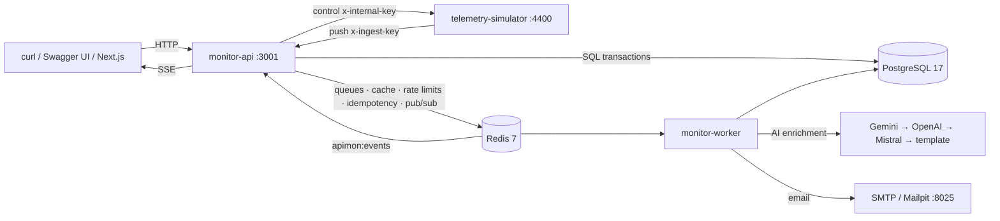
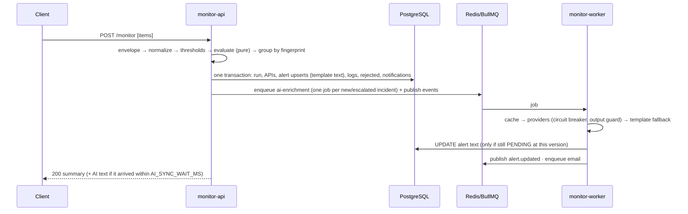

# Intelligent API Monitor

Ingests API response telemetry, detects anomalies with a **pure, deterministic engine**, writes human-readable alerts
with an **LLM** (Gemini → OpenAI → Mistral failover, output guard, deterministic template fallback), stores everything
in **PostgreSQL**, serves active alerts at `GET /alerts`, streams changes over **SSE**, and **emails** critical
incidents. One command runs everything: `docker compose up --build`.

The UI is a separate **Next.js** app built later; this repository delivers its API contract
([docs/FRONTEND_INTEGRATION.md](docs/FRONTEND_INTEGRATION.md), [docs/openapi.yaml](docs/openapi.yaml)).

## Features

- `POST /monitor` accepts the assignment's JSON array (also wrapped batches and single objects), up to 1000 items.
- Eight anomaly rules (server/auth/client errors, latency, zero/missing records, invalid metrics, unexpected status),
  per-API latency thresholds, CRITICAL/WARNING severity.
- **Incident deduplication**: a repeating failure updates one alert (`occurrence_count`) instead of creating hundreds;
  WARNING → CRITICAL escalates in place.
- **One AI call per incident** (not per log), queued with BullMQ, cached, behind circuit breakers; the template is
  always a valid fallback, so alerts never wait on an LLM.
- Realtime SSE stream with single-use tickets; email via SMTP (Mailpit locally), at most two emails per incident.
- Role-based auth (reused & hardened from the original module): JWT access tokens + rotated refresh cookies with reuse
  detection, argon2id, brute-force throttling, audit log.
- Telemetry simulator with 12 scenarios and a continuous stream; reconciler, auto-resolve and retention jobs.
- OpenAPI 3.1 contract + Swagger UI, `api.http`, contract tests that keep routes and docs in sync.

## Architecture





Details: [docs/ARCHITECTURE.md](docs/ARCHITECTURE.md).

## Quick start

Requirements: Docker with Compose v2. (Node.js 22+ only for running tests or host mode.)

```bash
cp .env.example .env
docker compose up --build -d
docker compose ps        # every service healthy within ~1–3 minutes
```

| What             | URL                        |
| ---------------- | -------------------------- |
| API              | http://localhost:3001      |
| Swagger UI       | http://localhost:3001/docs |
| Simulator        | http://localhost:4400      |
| Mailpit (emails) | http://localhost:8025      |

Admin login (local only, from `.env.example`): `admin@example.com` / `dev-only-Admin-2026`.
`DEMO_MODE=true` in `.env.example` lets anonymous callers ingest and read alerts; production refuses to start with it.

## Try the assignment example

```bash
curl -s -X POST localhost:3001/monitor -H 'Content-Type: application/json' -d @data/samples/pdf-example.json
curl -s localhost:3001/alerts
```

`PatientDataAPI` is healthy; `AppointmentAPI` becomes one ACTIVE **CRITICAL** alert (`SERVER_ERROR`, `HIGH_LATENCY`,
`ZERO_RECORDS`). Without an LLM key the message is exactly:

> AppointmentAPI failed with status 500 and returned 0 records (response time 5500 ms). Possible outage or data issue.

Send it again: still one alert, `occurrence_count: 2`. Mailpit shows one CRITICAL email.

More: `npm run ingest:file -- data/samples/edge-cases.json`, every request in [docs/api.http](docs/api.http), or run
a scenario through Swagger UI (`POST /api/v1/simulator/scenarios/outage-burst`).

## Email notifications

Locally, every email goes to **Mailpit** (http://localhost:8025): nothing leaves your machine, which is why a test
email to a real address shows "accepted" but never arrives in that inbox.

- **Change recipients** without a restart: dashboard → Settings → Alert emails (or `PATCH /api/v1/settings/notifications`).
  Until you save a list there, `ALERT_EMAIL_TO` from `.env` is used.
- **Check delivery**: Settings → "Send test email" reports exactly what the SMTP server answered.
- **Send real email**: point the SMTP settings in `.env` at a real provider, then `docker compose up -d` (API + worker):

```dotenv
EMAIL_ENABLED=true
SMTP_HOST=smtp.gmail.com        # or smtp.resend.com, smtp.sendgrid.net, email-smtp.<region>.amazonaws.com, …
SMTP_PORT=465                   # 465 = TLS from the start; use 587 with SMTP_SECURE=false for STARTTLS
SMTP_SECURE=true
SMTP_USER=you@gmail.com         # provider username (Resend: "resend", SendGrid: "apikey")
SMTP_PASSWORD=<app password or API key>
EMAIL_FROM=API Monitor <you@gmail.com>   # must be an address/domain the provider lets you send from
ALERT_EMAIL_MIN_SEVERITY=CRITICAL        # or WARNING to email every incident
```

Gmail needs 2-step verification and an **App password** (Google Account → Security → App passwords); your normal
password is rejected. Providers such as Resend or SendGrid need a verified sender domain. Compose overrides `SMTP_HOST`
with `mailpit` only when it is empty.

## Enabling a real LLM

Set a key **and** a model for any provider in `.env`, then `docker compose up -d`:

```dotenv
GEMINI_API_KEY=...
GEMINI_MODEL=<a current fast Gemini model id>
AI_PROVIDER_ORDER=gemini,openai,mistral
```

Unconfigured providers are skipped. Alerts show `ai_status: COMPLETED` and `ai_provider`/`ai_model`; any failure falls
through to the next provider and finally the template (`FALLBACK`). Provider circuit states appear in `GET /health`.

## Assignment coverage

| Assignment item                 | Implementation                                                                          | Proof                                      |
| ------------------------------- | --------------------------------------------------------------------------------------- | ------------------------------------------ |
| 5.1 Static JSON file            | `data/samples/*.json`, `POST /api/v1/monitor/static`, `npm run ingest:file`, Swagger UI | integration `ingestion.test.ts` §12, smoke |
| 5.2 `POST /monitor`             | `/monitor` and `/api/v1/monitor`; exact PDF array                                       | integration §1                             |
| 6.1 Evaluate time, status, data | normalizer + anomaly engine                                                             | `anomaly-engine.test.ts` (§7.4 table)      |
| 6.2 High response time          | `HIGH_LATENCY`                                                                          | unit                                       |
| 6.2 Failed requests             | `SERVER_ERROR`, `AUTH_FAILURE`, `CLIENT_ERROR`                                          | unit                                       |
| 6.2 Missing or zero records     | `MISSING_RECORDS`, `ZERO_RECORDS`                                                       | unit                                       |
| 6.3 LLM-generated alerts        | AI worker, failover, output guard, template fallback                                    | unit + `ai-enrichment.test.ts`             |
| 7.1 Store anomalies             | PostgreSQL `alerts` + `telemetry_logs`                                                  | integration                                |
| 7.2 REST `/alerts` (active)     | `GET /alerts`, `GET /api/v1/alerts` (default `ACTIVE`)                                  | integration                                |
| 7.3 Frontend                    | Contract for the later Next.js app: OpenAPI, Swagger UI, CORS, cookies, SSE             | `contract.test.ts`                         |
| 7.4 Email (optional)            | BullMQ email jobs via SMTP (Mailpit)                                                    | `realtime-jobs.test.ts`, Mailpit           |
| 8 Node.js / Express, modular    | Express 5 + TypeScript, routes → controller → service → repository                      | code                                       |
| 8 Batch processing              | ≤ 1000 items, chunked transactional writes                                              | integration (1000 items)                   |
| 8 Error handling                | typed errors, central handler, per-item rejection                                       | integration                                |
| 8 Logging                       | pino JSON logs with request ids, redaction                                              | logs                                       |
| 10 Scalability                  | queued AI, incident dedup, Redis caching, stateless API, scalable workers               | [ARCHITECTURE.md](docs/ARCHITECTURE.md)    |

## Anomaly rules

Every metric is evaluated independently; thresholds are inclusive; a null metric skips rules that need it.

| Priority | Code                | Condition                                                    | Severity           |
| -------- | ------------------- | ------------------------------------------------------------ | ------------------ |
| 1        | `SERVER_ERROR`      | 500 ≤ status ≤ 599                                           | CRITICAL           |
| 2        | `AUTH_FAILURE`      | status 401 or 403                                            | CRITICAL           |
| 3        | `INVALID_METRICS`   | any malformed field, or missing status/latency               | WARNING            |
| 4        | `CLIENT_ERROR`      | 400–499 except 401/403 (includes 429)                        | WARNING            |
| 5        | `HIGH_LATENCY`      | ≥ critical threshold → CRITICAL; ≥ warning → WARNING         | WARNING / CRITICAL |
| 6        | `MISSING_RECORDS`   | `records_returned` absent, status ≠ 204, API expects records | WARNING            |
| 7        | `ZERO_RECORDS`      | `records_returned` = 0, status ≠ 204, API expects records    | WARNING            |
| 8        | `UNEXPECTED_STATUS` | 100–199 or 300–399                                           | WARNING            |

Default thresholds 2000 / 5000 ms; per API via `PATCH /api/v1/apis/:name/thresholds`. Items are rejected only when
they cannot be attributed to an API (not an object, or invalid `api_name`); unknown fields are dropped, never stored.
An incident is identified by `sha256(api_name | sorted codes)`, so a different symptom set is a different incident.

## AI design

- **AI enriches, never decides**: detection and severity are deterministic; the LLM only writes the text.
- **Prompt** (`alert-v1`): fixed system prompt; the anomaly is sent as JSON inside `<telemetry>` tags and treated as
  data. `api_name` is pattern-restricted, which blocks prompt injection through the only free-text field.
- **Output guard**: JSON only, exact keys and lengths, must contain the exact `api_name`, and every number in the
  message must appear in the input (or be a latency in seconds). Anything else → next provider.
- **Fallback**: deterministic template, also used as the initial text, so alerts are useful immediately.
- **Cost control**: one call per incident (new, escalated, or manual regenerate), cache keyed by exact metrics
  (24 h), circuit breaker per provider (3 failures → open 60 s), simulator stream auto-stops.

## Configuration

All variables are documented in [.env.example](.env.example) and validated at startup (`apps/monitor-api/src/config/env.ts`).
Highlights: `DEMO_MODE`, `CORS_ALLOWED_ORIGINS`, `LATENCY_WARNING_MS`/`LATENCY_CRITICAL_MS`, `MAX_BATCH_SIZE`,
`AI_PROVIDER_ORDER` + provider keys/models, `AI_SYNC_WAIT_MS`, `EMAIL_ENABLED`, `ALERT_EMAIL_MIN_SEVERITY`,
`ALERT_AUTO_RESOLVE_MINUTES`, `TELEMETRY_RETENTION_DAYS`. With `APP_ENV=production` the API refuses to start with demo
mode, any `dev-only-` secret, insecure cookies, or plain-http CORS origins.

## Development

```bash
npm install
npm run dev:infra          # postgres, redis, mailpit in Docker
npm run db:migrate
npm run dev                # api + worker + simulator on the host (watch mode)
```

| Command                           | Does                                                          |
| --------------------------------- | ------------------------------------------------------------- |
| `npm run lint` / `npm run format` | ESLint (type-aware) / Prettier                                |
| `npm run typecheck`               | `tsc --noEmit` in every workspace                             |
| `npm run test:unit`               | unit tests, no infrastructure                                 |
| `npm run test:integration`        | needs `npm run dev:infra` (uses `apimon_test` and Redis DB 1) |
| `npm run test:contract`           | routes ↔ OpenAPI, response schemas, CORS, cookies             |
| `npm test`                        | all of the above                                              |
| `npm run db:generate`             | new migration after editing the Drizzle schema                |
| `npm run smoke`                   | end-to-end check against the running compose stack            |

## Project structure

```
apps/monitor-api/           API (src/server.ts) and worker (src/worker.ts), same image
  src/config/               Zod-validated env
  src/http/                 secure-router (every route declares access), middleware
  src/modules/              auth, users, audit, monitoring (+ pure anomaly-engine), alerts, apis, ai, notifications, realtime, simulator, health, docs
  src/jobs/                 BullMQ processors and schedulers
  src/infrastructure/       database (Drizzle schema, migrator), redis, queues, mail, logger
  drizzle/                  committed SQL migrations
  test/                     unit, integration, contract
apps/telemetry-simulator/   synthetic telemetry, scenarios, stream controller
packages/shared/            @apimon/shared: codes, permissions, DTO and event types
data/samples/               pdf-example, sample-telemetry, edge-cases
docs/                       spec, architecture, security, decisions, audit, OpenAPI, api.http, frontend guide
scripts/                    smoke-test.mjs, ingest-file.mjs
```

## Security summary

Deny-by-default RBAC (`ROLE_PERMISSIONS`; only `ADMIN` has permissions, `MANAGER` is reserved), every route declares its
access, strict request schemas, argon2id, 15-minute JWTs, rotated refresh cookies with reuse detection, Redis-backed
login throttling, CORS allowlist, CSRF `Origin` check, rate limits, no raw payload storage, log redaction, audit trail.
Threat model: [docs/SECURITY.md](docs/SECURITY.md). This project does not claim HIPAA compliance.

## Trade-offs and future work

- Telemetry is append-only in one table with batched retention; at scale, partition `telemetry_logs` by time.
- Single-tenant; multi-tenant isolation would add a tenant id to every table and token.
- Email only; Slack/PagerDuty would be additional notification channels on the same queue.
- Fixed thresholds; baselines learned from history (per-API percentiles) would reduce noise.
- `/metrics` (Prometheus) is specified as optional and not implemented yet.
