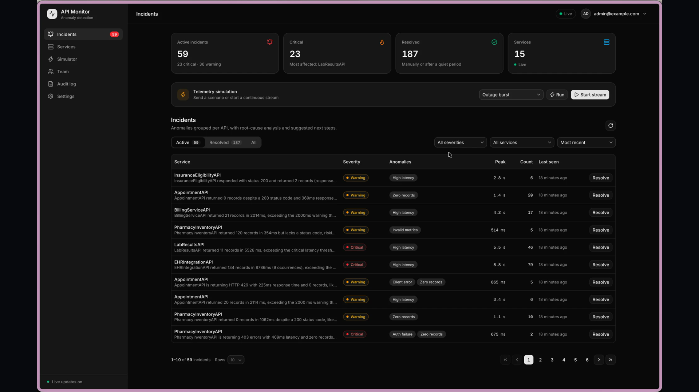
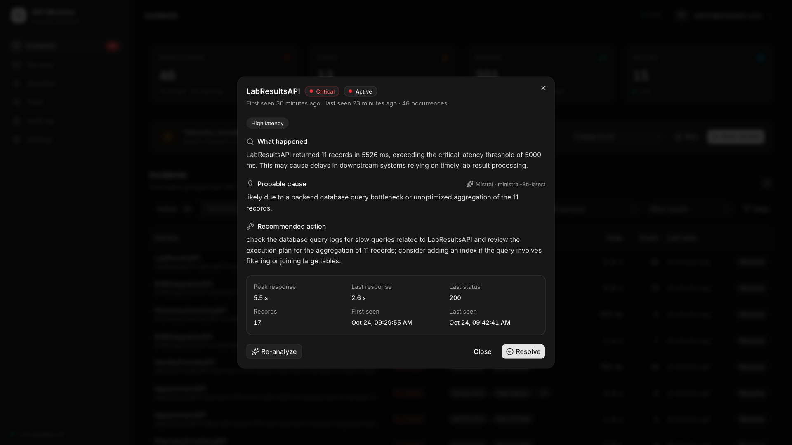
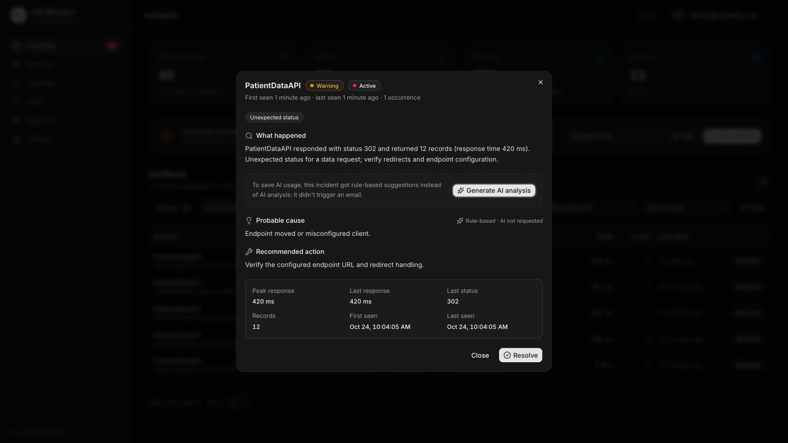
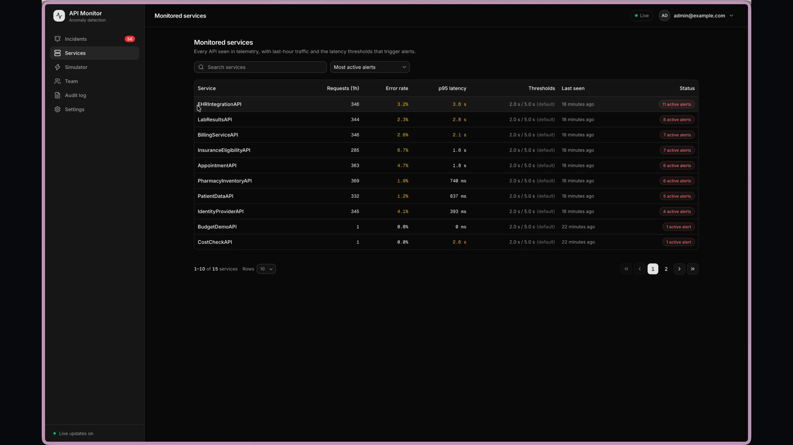
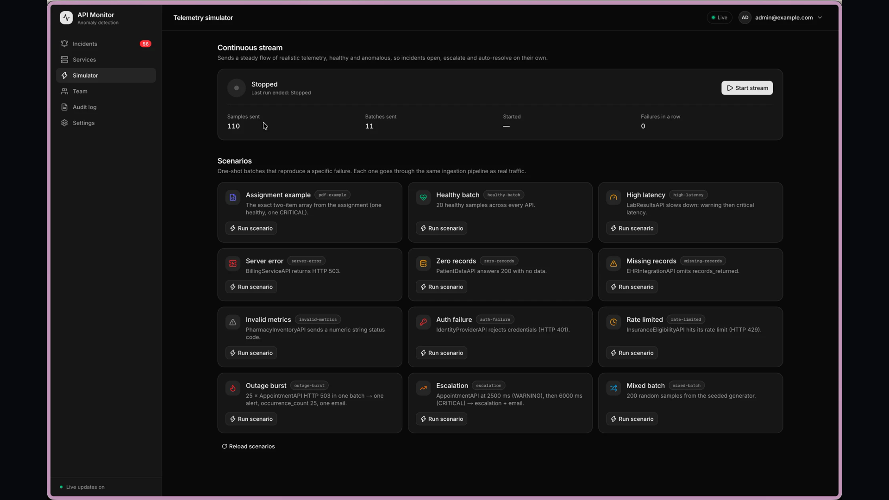
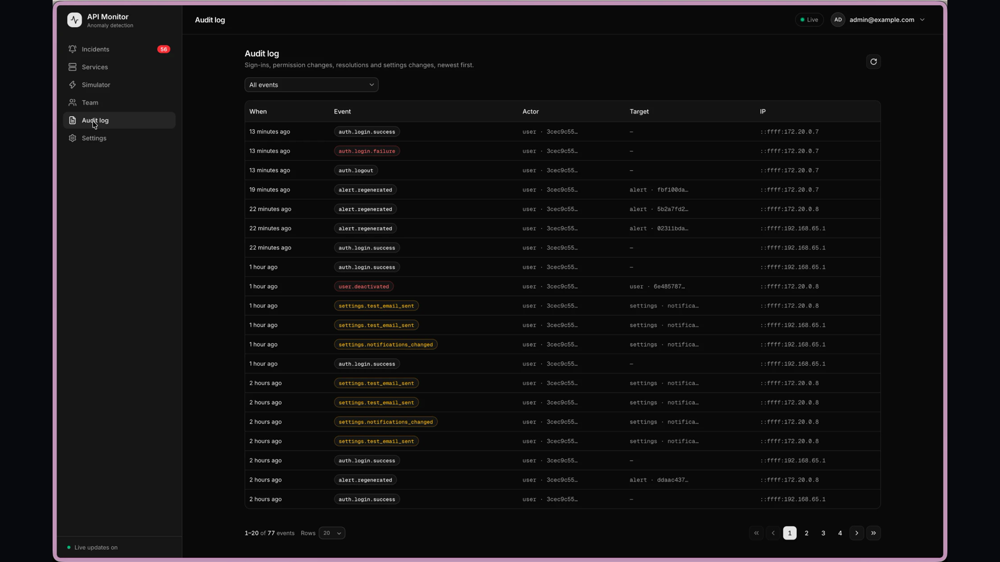
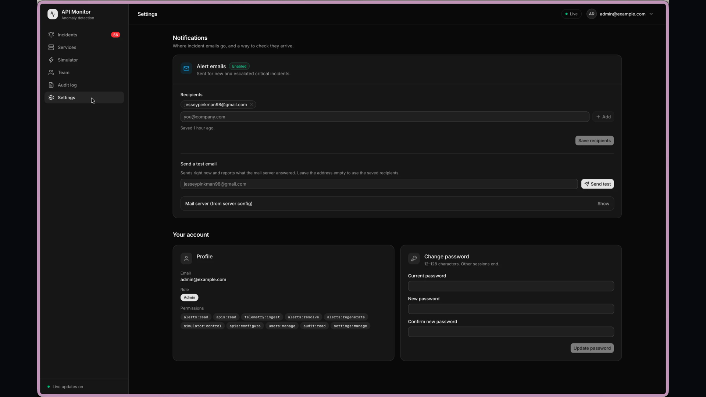
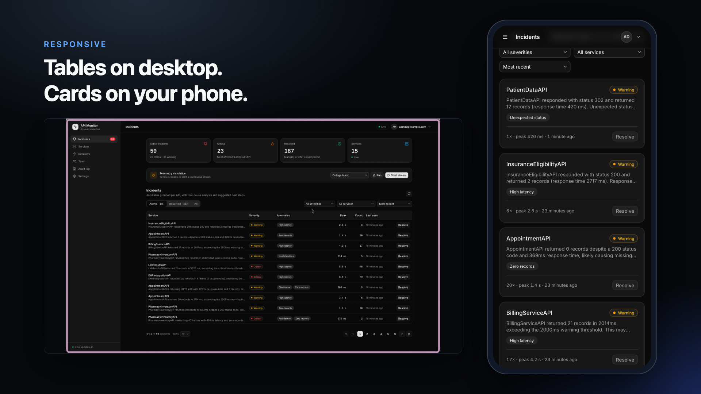

# 🚀 Intelligent API Monitor & Alert System

A modern, production-grade telemetry monitoring platform with deterministic anomaly detection, BullMQ background queues, AI incident analysis (Mistral / Gemini / OpenAI), realtime SSE streams, and an interactive Next.js dashboard.

---

## 📂 Project Structure & File Map

Here is the exact structure of this monorepo so you can navigate directly to any component:

```
pro-api/
├── apps/
│   ├── backend/                 # @apimon/backend — Express 5 API, anomaly engine, BullMQ worker & Drizzle migrations
│   │   ├── src/                 # Controllers, services, anomaly rules, HTTP routers, BullMQ queues
│   │   ├── drizzle/             # Database SQL migration files
│   │   └── Dockerfile           # Backend container definition
│   ├── frontend/                # @apimon/frontend — Next.js 16 dashboard (shadcn/ui + Tailwind CSS)
│   │   ├── app/                 # Next.js App Router (dashboard, alerts, services, simulator, settings)
│   │   ├── components/          # Reusable UI components & shadcn/ui library
│   │   └── Dockerfile           # Multi-stage Next.js production runner
│   └── simulator/               # @apimon/simulator — synthetic telemetry & burst scenario generator
│       ├── src/                 # Scenario definitions, continuous streaming generator
│       └── Dockerfile           # Simulator container definition
├── packages/
│   └── shared/                  # @apimon/shared — shared TypeScript interfaces, DTOs & constants
├── data/
│   └── samples/                 # Sample telemetry JSON files (pdf-example.json, edge-cases.json)
├── docker/
│   └── postgres/                # PostgreSQL init scripts & health checks
├── docs/                        # Architecture specs, OpenAPI 3.1 definitions & media
│   ├── openapi.yaml             # Complete API contract
│   └── video/screens/           # UI walkthrough screenshots
├── scripts/                     # Smoke tests (smoke-test.mjs) & ingestion scripts
├── compose.yaml                 # Multi-container orchestration (all 7 services)
├── package.json                 # Monorepo root npm workspace definitions
└── .env.example                 # Environment configuration template
```

---


## ⚡ One-Line Quick Start

Set up your environment and launch the entire stack in Docker with a single command:

```bash
cp -n .env.example .env && docker compose up --build -d
```

> **Note:** Run `docker compose ps` to verify all 7 services are running and healthy.

---

## 🌐 Services, Ports & Credentials

| Service | URL | Description |
| :--- | :--- | :--- |
| **Web Dashboard** | [http://localhost:3000](http://localhost:3000) | Next.js frontend with shadcn/ui dashboard |
| **Monitor API** | [http://localhost:3001](http://localhost:3001) | Express REST API & Realtime SSE feed |
| **Swagger UI** | [http://localhost:3001/docs](http://localhost:3001/docs) | Interactive OpenAPI 3.1 documentation |
| **Simulator** | [http://localhost:4400](http://localhost:4400) | Synthetic telemetry & burst scenario generator |
| **PostgreSQL** | `localhost:5432` | Relational storage (`apimon` database) |
| **Redis** | `localhost:6379` | BullMQ queues, caching, and pub/sub |

### Default Admin Credentials

- **Email:** `admin@example.com`
- **Password:** `Admin@123456!`

---

## 🚀 Setup & Execution Guide

### Prerequisites

- **Docker** & **Docker Compose v2+** (recommended)
- **Node.js 22.18+** and **npm** (only required for local host development)

---

### Option A: Run via Docker (Recommended)

1. **Configure Environment:**
   ```bash
   cp -n .env.example .env
   ```
   *(Optional)* Add your `MISTRAL_API_KEY`, `OPENAI_API_KEY`, or `GEMINI_API_KEY` in `.env` for AI features.

2. **Launch All Services:**
   ```bash
   docker compose up --build -d
   ```

3. **Useful Docker Commands:**
   ```bash
   docker compose ps         # View container health status
   docker compose logs -f    # Stream live logs for all services
   docker compose down       # Gracefully stop all containers
   ```

---

### Option B: Local Host Development (Hot Reload)

If you prefer local development with instant hot reloading:

1. **Install All Dependencies & Create `.env`:**
   ```bash
   npm run setup
   ```
   *(Runs `cp -n .env.example .env && npm install` covering all workspaces)*

2. **Start Postgres & Redis, then Run Migrations:**
   ```bash
   npm run dev:infra
   npm run db:migrate
   ```

3. **Start All Applications with Hot Reload:**
   ```bash
   npm run dev
   ```
   *Or run components individually:*
   - Backend & Worker: `npm run dev:backend`
   - Frontend Dashboard: `npm run dev:frontend`
   - Simulator: `npm run dev:simulator`

---

## 🛠 Features & Capabilities

- **High-Throughput Ingestion:** `POST /monitor` handles batches up to 1,000 items with atomic PostgreSQL transactions.
- **8-Rule Anomaly Detection Engine:** Real-time deterministic detection of server errors (`5xx`), auth failures (`401`/`403`), client errors (`4xx`), latency spikes, zero/missing records, and invalid metrics.
- **Incident Deduplication:** Repeating issues update occurrence counters instead of cluttering the feed; auto-escalates `WARNING` → `CRITICAL`.
- **AI-Powered Diagnostics:** Enriches incidents via Mistral (`ministral-8b-latest`), OpenAI, or Gemini with automatic fallback to deterministic templates.
- **Live Realtime Feed:** Server-Sent Events (SSE) stream new anomalies and updates instantly to the UI.
- **Email Notifications:** Configurable SMTP email alerts for critical incidents.
- **Synthetic Simulator:** 12 built-in outage scenarios and continuous traffic streaming for end-to-end testing.

---

## ✅ Quality Checks & Testing

```bash
npm run lint && npm run typecheck && npm run test:unit   # Linting, types, and unit tests
npm run test:integration && npm run test:contract        # Integration & OpenAPI contract tests (requires dev:infra)
npm test                                                 # Run all test suites
npm run smoke                                            # End-to-end smoke test against running services
```
---

## 🎬 Video Walkthrough & Live Demo

Watch the full system demo walkthrough below:

<div align="center">
  <p>
    <a href="https://vikingfile.com/f/lhDxe4iR7H" target="_blank" rel="noopener noreferrer">
      
      <br/>
      ▶️ <b>Click here to open the video</b>
    </a>
  </p>
</div>

---

## 📸 Visual Showcase

### 1. Real-Time Incidents Feed & Deduplication
Live Server-Sent Events (SSE) feed automatically groups repeating anomalies into unified incidents with severity indicators (`WARNING` / `CRITICAL`):


---

### 2. AI Root Cause Analysis (Mistral / OpenAI / Gemini)
Generate on-demand, contextual LLM diagnostics explaining the exact anomaly symptoms, affected metrics, and suggested remediations:

| AI Analysis Modal | On-Demand Generation |
| :---: | :---: |
|  |  |

---

### 3. Monitored Services & Outage Simulator
Real-time health status, P95 latency metrics, and an integrated synthetic scenario generator (12 burst patterns):

| Monitored Services | Telemetry Simulator |
| :---: | :---: |
|  |  |

---

### 4. Audit Log, Settings & Responsive UI
Full RBAC audit trail, customizable SMTP email notifications, and mobile-friendly responsive layout:

| Security Audit Trail | Alert Settings & SMTP |
| :---: | :---: |
|  |  |



---
